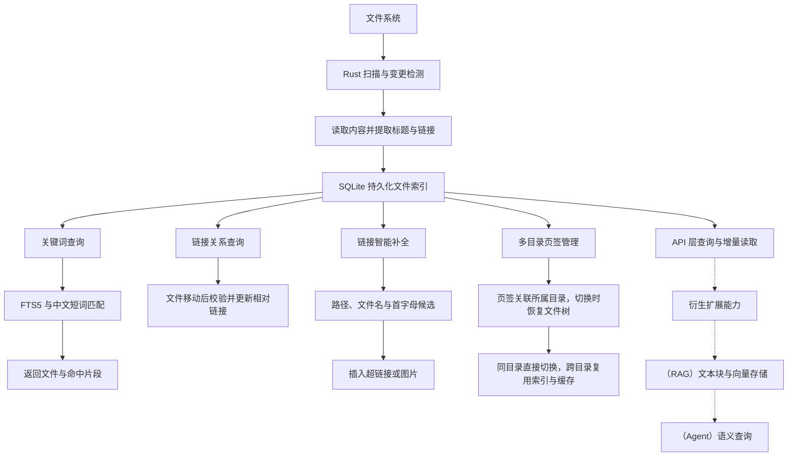

# Markart

本地 Markdown 编辑器。可通过 GitHub 私有仓库或 WebDAV 同步。

基于 Tauri 2、Vue 3、CodeMirror 6 和 Rust 。

[下载最新版本](https://github.com/Chikomago/Markart/releases/latest) · [查看源码](https://github.com/Chikomago/Markart)

本项目不提供插件审核，可自行创建。

## 项目功能

- **基础编辑**：标题、行内样式、任务列表、表格、脚注、公式和 Front matter；支持查找替换、快捷键和 `/` 菜单。
- 编辑视图：提供所见即所得、源码和分栏三种视图。
- **图表渲染**：流程图和脑图渲染，提供类xmind可视化图上编辑。
- **文件管理**：多目录页签、文件树、文件列表、大纲与筛选；支持模板、片段和自定义。
- **多页签**：页签之间相互隔离，不依赖当前打开工作区，切换页签时打开对应文件所在根目录。
- **工具栏**：类typora式悬浮工具栏。
- **云同步**：GitHub、WebDAV自动同步，自动查询父级目录，使用钥匙串/凭据存储。
- **版本管理**：内置libgit2，支持变更对比和历史版本恢复。
- **外观布局**：内置主题/自定义主题，自由管理面板布局。
- **扩展开发**：开放大量[API](./docs/plugins.md)。
- **索引架构**：由 Rust 层统一管理SQLite 建立文件持久化基础索引，扩展出关键字搜索、目录隔离、链接智能补全，链接更新等，亦可扩展向量能力。

## 索引

Rust 统一维护 SQLite 持久化文件索引





## 运行

桌面端：

```sh
npm ci
npm run desktop
```

WEB端：

```sh
npm run dev
```

<http://127.0.0.1:5173/>

## 构建


`npm run build`

`npm run desktop:build`

正式发布使用 [GitHub Actions](.github/workflows/release.yml) 构建 macOS、Windows 和 Linux 安装包，并生成签名更新文件。发布步骤见 [docs/releasing.md](docs/releasing.md)。


## 开发

[插件 API](docs/plugins.md)：接口参考、类型、参数和示例；[发布规范](docs/plugins/publishing.md)。

[主题](docs/themes.md)：主题文件夹、清单、多文件样式和配色变量。

## 协议

[GPL-3.0-only](LICENSE)。作者：chikomago。
