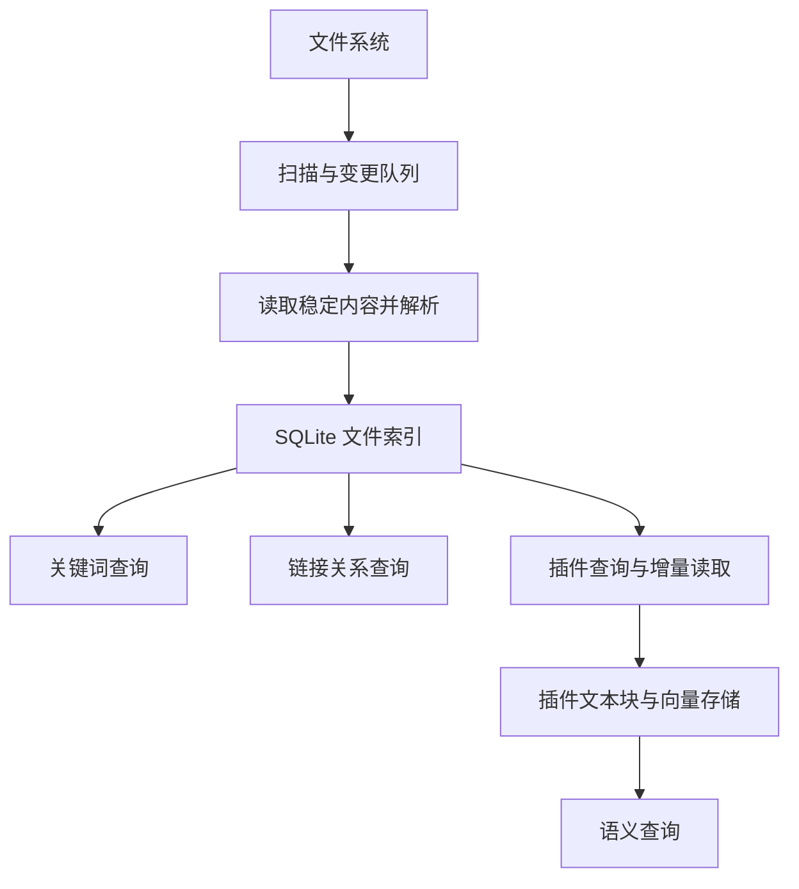

# 文件索引与插件数据方案

状态：基础索引、后台队列、共享目录索引、损坏恢复、结构化查询和插件变更订阅已接入。向量存储由插件实现。

插件接口见 [文件索引 API](../plugins/index.md)。

### 当前实现

- Rust 管理应用数据目录中的 `file-index/catalog.sqlite3`。按规范化绝对路径存储文件，父子目录共享文件 ID、内容版本及关系数据；宿主 API 将查询限定在当前文件夹，并返回相对路径。
- SQLite 保存内容哈希、版本、UTF-8 正文、目录、标准 Markdown 标题、YAML 属性、标签及本地链接位置。正文与派生数据使用同一事务；位置使用原始索引正文的 UTF-16 偏移。
- 文件保存按路径更新；创建、删除和移动同步更新索引。后台原生监听合并约 150 毫秒内的事件，队列上限 512 条；目录变更、事件溢出及监听异常时重新核对。失败重试的空闲间隔上限 30 秒。
- 文件夹关闭或切换时停止对应队列。宿主移动文件时与后台写入互斥，保持文件 ID。扫描跳过符号链接；二进制及超过 20 MiB 的文件仅保留元数据。
- 数据库和全文索引进行完整性检查。确认损坏后，将缓存及附属文件保留为 `catalog.corrupt-*`，再从文件系统重建。权限、路径和锁定错误不会触发清空。旧的根目录缓存按首次打开路径迁入，共享索引中已有的文件不会被旧缓存覆盖。

### 查询与订阅

分页读取、版本正文、标题属性、标签及链接关系通过 `api.index` 提供。单次分页请求在同一 SQLite 读事务内获取游标和数据。游标绑定文件夹及索引实例；分页间发生写入时重新获取首页。

变更日志与文件更新同事务提交，保留最近 10,000 条记录。提交后发送游标通知；插件用原游标读取完整增量。回调串行执行，重复通知合并；取消订阅、停用插件或切换文件夹时清理监听。缓存重建后旧游标失效。

打开文件夹、首次建库、移动和刷新在后台任务执行。首次打开仍等待索引核对完成；不将首次建库耗时描述为打开时间已消除。

链接智能补全已接入索引：桌面端调用 `query_link_completions(root, source, query, folder)`，Rust 在 SQLite 中按文件名、首字母及目录范围筛选候选，不读取文件正文。`folder = null` 搜索整个工作区，空字符串表示根目录。前端识别输入意图、生成相对路径并展示列表，CodeMirror 合并连续输入请求，过期响应不进入候选列表。网址前缀在前端补全；浏览器预览、未打开文件夹或索引查询失败时使用前端文件列表。

索引结构已升级到版本 4，包含父目录索引、目录表、规范化搜索文本和 FTS5 全文索引，升级时保留已有文件身份与版本。文件、目录和全文索引随文件更新共同提交，包含空目录。

文件夹关键词搜索已接入 SQLite FTS5：使用 trigram 召回三个及以上字符的子串，单字、双字查询使用规范化文本上的 `instr` 字面匹配。文件名与正文统一处理 Unicode 小写，命中正文后按原始行生成片段，不将搜索词解释为 FTS 运算符。当前文件查找继续使用编辑器缓冲区；文件夹搜索以未保存内容覆盖对应磁盘结果，保留 `||`、`&&`。外部文件列表刷新会重新查询，索引不可用时回退原有文件扫描。正文索引沿用 UTF-8、20 MiB 以内的文本范围，二进制附件只参与文件名匹配。

实现入口：`src-tauri/src/file_index.rs`；工作区接入：`src-tauri/src/workspace.rs`。以下为完整目标方案。

## 1. 目标与边界

宿主维护可重建的文件索引，向搜索、链接更新及插件提供一致的数据。插件按需生成文本块、向量等派生数据。

| 宿主负责 | 插件负责 |
| --- | --- |
| 文件身份、路径、内容版本和变更记录 | 文本切块、摘要、向量及模型选择 |
| 原始文本、标题、属性、标签、链接的提取 | 语义检索、重排和生成等处理 |
| 关键词查询、精确链接关系、索引重建 | 向量存储、插件数据迁移及清理 |
| 索引查询接口与增量变更接口 | 插件界面与功能逻辑 |

文件是内容来源，数据库是索引。删除索引不应删除文件，重建索引不应改写文件。

这里的两部分是职责划分，不要求使用两个数据库。宿主采用 SQLite；插件可以选择文件、本地数据库或远程服务。宿主不内置向量模型，也不要求用户配置向量存储。

## 2. 当前实现

| 功能 | 当前方式 | 主要位置 |
| --- | --- | --- |
| 当前文件查找 | 对编辑器文本执行匹配，可包含未保存内容 | `src/editor/documentSearch.ts` |
| 文件夹搜索 | SQLite FTS5 与短词字面匹配，保留实时编辑缓冲区覆盖 | `src-tauri/src/workspace.rs` 的 `search_workspace` |
| 文件移动与链接更新 | 索引查询相关来源文件，校验后重写相对链接 | `src-tauri/src/workspace.rs` 的 `plan_move`、`src-tauri/src/link_paths.rs` |
| 插件文件编辑 | 读取快照，以运行期 revision 校验批量修改 | `src/plugins/sdk.ts`、`src/plugins/runtime.ts` |

已具备持久化文件索引、全文索引与反向链接查询；向量存储仍由后续插件扩展。

## 3. 总体结构



SQLite 由 Rust 层统一管理，前端与插件通过宿主服务访问，不直接操作数据库表。解析和建索引在后台任务执行，不占用编辑器交互线程。

数据库放在应用数据目录，不放进用户文件夹，不随 Git 或 WebDAV 同步。每台设备根据自己的文件重建索引；同步来的文件变更通过同一条索引更新流程处理。

### 文件夹范围

索引服务独立于当前文件树的展示范围。规范化根路径限定查询范围，索引实例标识与范围共同绑定游标。

- 打开已索引根目录的子目录：复用索引，只改变查询范围。
- 先索引子目录，再打开父目录：扩展为父目录索引范围，迁移已有文件身份，避免重复入库。
- 路径归一化后判断目录归属；符号链接默认不递归跟随，避免循环和重复。
- 未保存的新文件不进入持久化索引；保存后按实际路径纳入。
- 打开单文件时，沿用项目打开其父目录的行为，索引该目录。

索引范围与同步绑定范围分别管理。扩大文件树或索引范围，不自动扩大远端同步范围。

## 4. 数据模型

当前逻辑模型如下，SQL 与迁移在 `src-tauri/src/file_index.rs`。

| 数据 | 关键字段 | 用途 |
| --- | --- | --- |
| 范围 | 根路径、索引实例标识、提交序号 | 限定查询与校验游标 |
| 文件 | `fileId`、相对路径、类型、大小、内容哈希、`contentVersion` | 身份、去重更新与版本校验 |
| 正文 | `fileId`、原始文本、解析版本 | 全文检索与插件读取 |
| 结构 | `fileId`、种类、位置、值 | 标题、Front matter、标签等 |
| 链接 | 来源文件、原始目标、解析目标、位置、类型、解析状态 | 正向链接、反向链接与移动更新 |

关键词搜索索引从正文生成。变更日志另存提交序号、文件身份、变更类型及版本，供插件断点追赶。

### 身份与版本

`fileId` 使用本机索引分配的稳定标识。宿主移动或重命名文件时保留身份；内容变化递增 `contentVersion`。改回旧内容也产生新版本。

文件时间和大小用于快速筛查，内容哈希用于确认变化。哈希相同不等于文件身份相同，不能把两份相同内容的文件合并成一个文件。

外部移动目前按删除与新增处理；不依据相同正文猜测关联。跨设备不保证 `fileId` 相同。

持久化 `contentVersion` 与编辑器运行期 `revision` 分开使用：前者对应已保存文件，后者用于保护当前编辑缓冲区。插件写回仍通过带 revision 校验的编辑接口。

### 位置与解析

对外文本位置统一使用 UTF-16 偏移，范围为 `[from, to)`。Rust 内部解析产生的字节偏移在输出时转换，避免中文和表情位置错乱。

Markdown 提取标题、属性及本地链接；其他 UTF-8 文本先提供正文与关键词搜索，不强行按 Markdown 解释。二进制附件可以作为链接目标登记元数据，不进入正文搜索。

标签读取 Front matter 的 `tag`、`tags`，以及普通 Markdown 文字中的 `#标签`。代码、转义和实体不作为标签；标题标记本身不作为标签。

## 5. 索引如何保持更新

### 首次建立

1. 后台枚举范围内的文件。
2. 读取文本、计算哈希并解析结构；复用未变化文件的派生数据。
3. 在同一事务内写入正文、结构、链接、搜索索引和变更记录。
4. 提交后通知订阅方。
5. 原生监听启动后的文件事件进入队列，继续补处理。

打开文件夹的命令在后台执行，返回前完成首次索引核对；不对插件发布半成品快照。移动链接更新等要求完整结果的操作，先补齐相关索引或回退到现有扫描流程。

### 增量更新

宿主保存、移动和删除直接更新索引；外部修改及同步写入经文件事件队列更新。同一文件短时间内的重复事件合并处理。

读取前后检查文件状态；读取过程中再次变化则重试。发布结果前校验任务版本，旧解析任务不得覆盖新内容。文件、结构、链接及全文索引在同一事务中更新，避免查询到半套数据。

删除文件时移除其正文与出站链接，将其他文件指向它的链接标记为失效，保留原始目标供后续重新解析。新增目标或移动目标后重新检查相关失效链接。

### 未保存内容

持久化索引只记录已保存内容。当前文件查找继续读取编辑器缓冲区；文件夹搜索可用已加载文件的未保存内容覆盖对应磁盘结果，按 `fileId` 去重。

插件读取时明确选择磁盘快照或编辑器快照。首期语义索引以已保存内容为准，不把每次按键都提交给模型。

### 监听遗漏与故障

启动时和文件夹重新获得焦点后执行差异检查，弥补监听遗漏。读取失败保留上次提交的数据，记录错误并重试；读取版本表示上次索引快照，不是对磁盘瞬时状态的保证。

数据库损坏可重建；结构升级使用版本迁移。重建后变更游标失效，插件必须重新枚举快照。变更日志设置保留上限，避免无限增长。

## 6. 关键词搜索原理

关键词搜索解决明确文字的查找，向量搜索解决语义接近的内容召回，两者可以同时存在。

SQLite 全文索引用作候选召回，最终结果仍按原文和搜索选项验证。中文分词、子串、正则、通配符、忽略标点等匹配方式不能直接假设全文索引均支持。

实施时验证所选 SQLite 构建的全文检索能力与中文策略。没有适用索引的查询继续逐文件匹配；不能为了提速改变现有搜索含义。排序可以结合文件名命中、正文命中和位置，向量分数由插件另行提供。

## 7. 链接更新原理

链接库记录明确关系，例如：

```text
notes/a.md 的第 120～142 个字符
原始链接：../assets/chart.png
解析目标：assets/chart.png
```

移动 `assets/chart.png` 时按目标查反向链接，无需逐个重新解析所有文件。移动整个目录时查询该目录下的目标集合。

需要区分两种修改：

| 情况 | 处理 |
| --- | --- |
| 被链接的目标移动 | 更新其他文件指向它的相对路径 |
| 包含相对链接的来源文件移动 | 根据来源新位置调整其内部链接 |

第二种仍需执行，但不计入“其他文件引用已更新”的提示数量。数量按实际修改的链接处数统计。

执行前验证涉及文件的内容版本及原始片段，再生成改动计划；文件已变化时重新解析。提交沿用现有预览令牌与回滚保护，不能仅凭旧偏移直接替换。

未保存修改继续受编辑器保护。索引不完整或过期时，先补齐检查，不能因为反向查询结果为零就认定没有引用。首期仅重写现有解析器支持的链接，不扩展到任意文本中的路径。

## 8. 插件如何使用

只读入口为 `api.index`，类型集中在 `src/plugins/sdk.ts`，参考 [文件索引接口](../plugins/index.md)。

| 方法 | 内容 |
| --- | --- |
| `files()` / `content()` | 分页元数据与按版本读取正文 |
| `metadata()` / `tagged()` | 标题、YAML 属性、标签及按标签筛选 |
| `links()` | 分页查询正向、反向关系及原文位置 |
| `changes()` / `subscribe()` | 读取持久化变更、接收提交通知 |

分页请求在同一读事务内返回快照数据与游标，后续分页遇到写入时要求重新枚举。处理快照后从该游标读取变更；通知仅提示有新批次，可靠追赶以日志为准。

单页上限 500 条。停用插件或切换文件夹后，订阅取消、过期查询结果被丢弃。插件只保存自己的派生数据，不直接修改宿主表或依赖 SQLite 文件路径。

`documents` 编辑接口继续负责文件打开、编辑及保存。索引版本不替代编辑缓冲区的 revision 校验。

## 9. 文本块与向量存储

文本块是一段文件内容，不等于一个文件。例如按每块约 500 字估算，5,000 字的文件约有 10 块，1,000 个这样的文件约有 1 万块。实际数量由段落、标题、模型长度限制及重叠规则决定。

插件为每块记录以下关联：

```text
工作区 + fileId + contentVersion
文本范围 + 内容哈希 + 切块规则版本
向量模型标识 + 模型版本 + 向量维度
```

文件变化后重新切块，通过块内容哈希复用未变化的向量。位置改变但内容未变时，只更新位置。删除文件时移除对应块；更换模型或切块规则时建立新版本索引，避免混用不同维度和语义空间。

检索结果包含来源文件、位置和版本。使用结果前核对版本，防止打开旧位置或引用已经删除的内容。

### 存储与内存

向量落盘不代表全部常驻内存。内存消耗取决于查询索引、缓存、批处理规模和模型加载方式。

```text
10,000 块 × 768 维 × 每维 4 字节
= 30,720,000 字节，约 30.7 MB（29.3 MiB）
```

这只是原始 float32 向量，不包含正文、元数据、检索结构或模型。不能据此推算插件总内存。插件应限制缓存和并发，按需加载，停用时取消任务并释放资源。

宿主不决定插件使用哪种向量库，也不将向量结果用于精确链接改写。文件内容发送到远端模型或存储服务，由插件明确配置；宿主索引本身不需要网络。

## 10. 实施顺序与验收

每阶段独立交付，不把数据库迁移、搜索替换和向量能力一次上线。

| 阶段 | 交付 | 验收重点 |
| --- | --- | --- |
| 1. 索引基础 | SQLite、文件身份、正文、变更队列、重建 | 保存、外部增删改、重启后保持一致 |
| 2. 链接索引 | 结构提取、正反向关系、接入移动更新 | 未引用文件无误报；来源与目标移动均正确 |
| 3. 搜索接入 | 索引候选与原文验证、未保存覆盖 | 中文及现有高级条件结果与旧实现一致 |
| 4. 插件接口 | 分页快照、变更游标、订阅及接口文档 | 初始化无遗漏；断线、过期游标可恢复 |
| 5. 性能验证 | 大目录测试、队列与缓存调节 | 编辑流畅，资源占用有实测记录 |

测试覆盖空文件、中文及表情、重复内容、大小写路径、目录移动、失效链接恢复、写入中再次变化、监听丢失、进程中断与数据库重建。同步策略保持独立测试，索引不得改变远端优先或自动合并的行为。

性能测量见 [一万文件验证](file-index-performance.md)。该人工生成的数据集用于发现扫描和 SQL 问题，不代表所有用户文件夹。内存峰值、长期运行和跨平台结果未测量，不据此承诺固定容量。

## 11. 首期不包含

不内置向量模型或向量库，不实现语义搜索界面，不生成摘要，不构建跨设备统一文件身份，不替代文件同步机制。

首期完成后，宿主应能回答“有哪些文件、内容是什么、彼此如何链接、哪些内容发生变化”。插件在这些数据之上构建功能，无需各自重复扫描整个文件夹。


## 多目录页签

页签以目录根路径和目录内路径确定文件身份。同名文件位于不同目录时保留独立页签、正文、磁盘版本及未保存状态。切换同目录内的页签不重新打开索引；切换目录时恢复该目录的展开状态和滚动位置。

Rust 保留当前目录和最近 3 个目录上下文。再次激活缓存目录时，从 SQLite 的文件与目录记录生成列表，保留原磁盘版本基线；目录监听继续增量维护索引。超过缓存数量后释放旧上下文及其监听器，SQLite 索引仍保留，再次打开时校准磁盘变化。

读取、保存、草稿、历史版本和文件移动请求携带目录身份。切换前完成当前目录草稿暂存，并等待已有同步和保存任务结束。继承父目录同步绑定时，未保存页签的完整路径也纳入保护范围，包括当前文件树之外的兄弟目录。

保存临时文件只绑定该页签的目标路径，保留其他页签及未保存内容。保存到已有目录范围内时保留已有根目录；新目录按需建立上下文。文件管理器打开文件、最近打开和应用内打开使用同一入口，重复路径选中已有页签。

窗口状态只保存页签顺序、所属目录及当前文件；正文沿用文件和草稿存储机制。启动恢复时先加载当前文件所属目录，其余目录在点击页签后加载。
